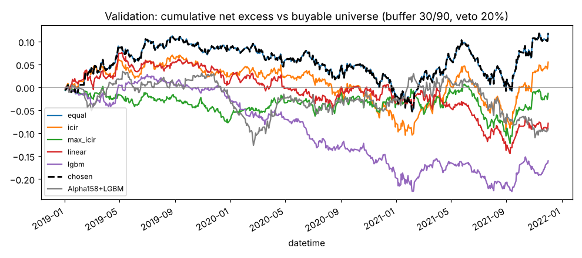
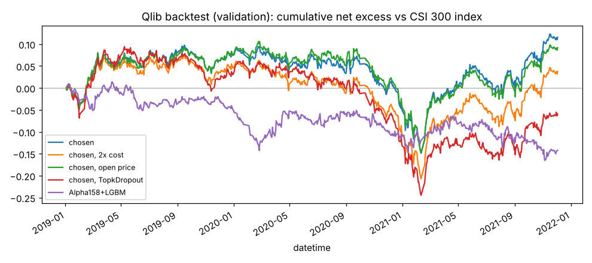

# 因子合成与验证段回测

- 样本：csi300 历史成分；权重只用训练段（2010–2018）估计，比较在验证段 2019-01-02 ~ 2021-12-02（段尾去掉 21 个交易日）
- 打分因子 11 个：CORD30, CORD60, CORR30, MA30, ROC60, CORR60, IMXD30, amihud20, vol20, MAX60, WVMA60
- 排雷因子 13 个：MA5, CORR5, CORD5, CORR10, pv_corr20, CORD10, VWAP0, IMXD5, SUMN5, MAX5, CNTN5, KLOW2, IMIN30；等权合成排雷分，每天最低 20% 不能新买，已持有的不受影响
- 交易规则：每日决策，持仓 30，缓冲 30/90；T 日收盘出信号，T+1 收盘成交
- 升级标准：和当前采用的方案比，每日扣成本超额之差年化 > 0 且 Newey-West t 值（滞后 5 阶）> 2

**选定方案：等权**

## 逐级比较（近似模拟，超额相对第二天能买进的股票）

| 方案             |   训练段 RankIC |   验证段 RankIC |   验证段 t 值 | 年化超额   | 成本   | 扣成本后   | 日均换手   | 比较对象   | 差距（年化）   |   差距 t 值 | 结果   |
|:-----------------|----------------:|----------------:|--------------:|:-----------|:-------|:-----------|:-----------|:-----------|:---------------|------------:|:-------|
| 等权             |          0.0488 |          0.0242 |          3.24 | 6.77%      | 2.58%  | 4.19%      | 2.88%      |            |                |             | 起点   |
| ICIR 加权        |          0.0511 |          0.0249 |          3.5  | 4.42%      | 2.45%  | 1.97%      | 2.74%      | 等权       | -2.22%         |       -1.02 | 不升级 |
| 最大化 ICIR      |          0.0511 |          0.0199 |          3.28 | 1.99%      | 2.45%  | -0.46%     | 2.73%      | 等权       | -4.65%         |       -0.89 | 不升级 |
| 线性回归         |          0.057  |          0.021  |          3.09 | 0.62%      | 3.40%  | -2.78%     | 3.81%      | 等权       | -6.97%         |       -1.71 | 不升级 |
| LightGBM         |          0.0761 |          0.0194 |          2.96 | -0.70%     | 4.99%  | -5.69%     | 5.62%      | 等权       | -9.89%         |       -2.1  | 不升级 |
| 等权 + 平滑 3 天 |                 |          0.0234 |          3.14 | 3.31%      | 2.35%  | 0.95%      | 2.62%      | 等权       | -3.24%         |       -1.76 | 不升级 |
| 等权 + 平滑 5 天 |                 |          0.0225 |          3.03 | 2.44%      | 2.19%  | 0.26%      | 2.43%      | 等权       | -3.94%         |       -1.89 | 不升级 |

LightGBM 在 2017–2018 早停，用了 4 轮。训练段 RankIC 是样本内的，LightGBM 的偏高属正常。

## 权重

各方法的权重按绝对值之和为 1 归一（合成后会再标准化，只有相对大小有意义）。最后一列是 LightGBM 的特征重要性（按增益）。

|          |   等权 |   ICIR 加权 |   最大化 ICIR |   线性回归 |   LightGBM 重要性 |
|:---------|-------:|------------:|--------------:|-----------:|------------------:|
| CORD30   |  0.091 |       0.170 |         0.165 |      0.132 |             0.052 |
| CORD60   |  0.091 |       0.164 |         0.193 |      0.131 |             0.171 |
| CORR30   |  0.091 |       0.118 |         0.067 |      0.036 |             0.038 |
| MA30     |  0.091 |       0.106 |         0.187 |      0.295 |             0.438 |
| ROC60    |  0.091 |       0.078 |         0.000 |      0.049 |             0.021 |
| CORR60   |  0.091 |       0.075 |        -0.025 |      0.014 |             0.069 |
| IMXD30   |  0.091 |       0.068 |        -0.122 |     -0.074 |             0.027 |
| amihud20 |  0.091 |       0.067 |         0.082 |      0.049 |             0.084 |
| vol20    |  0.091 |       0.061 |         0.005 |      0.097 |             0.056 |
| MAX60    |  0.091 |       0.047 |        -0.119 |     -0.121 |             0.021 |
| WVMA60   |  0.091 |       0.046 |         0.035 |      0.004 |             0.024 |

## 排雷比例对照

验证段：

| 排雷比例   |   RankIC | 年化超额   | 成本   | 扣成本后   | 日均换手   | 和 20% 的差距   |   差距 t 值 |
|:-----------|---------:|:-----------|:-------|:-----------|:-----------|:----------------|------------:|
| 20%        |   0.0242 | 6.77%      | 2.58%  | 4.19%      | 2.88%      |                 |             |
| 10%        |   0.0242 | 8.14%      | 2.58%  | 5.56%      | 2.88%      | 1.37%           |        2.43 |
| 不排雷     |   0.0242 | 8.35%      | 2.58%  | 5.77%      | 2.88%      | 1.58%           |        1.57 |

同样的对照放在训练段（样本内，权重也是在这一段估的）上：

| 排雷比例   |   RankIC | 年化超额   | 成本   | 扣成本后   | 日均换手   | 和 20% 的差距   |   差距 t 值 |
|:-----------|---------:|:-----------|:-------|:-----------|:-----------|:----------------|------------:|
| 20%        |   0.0488 | 6.43%      | 2.80%  | 3.63%      | 3.16%      |                 |             |
| 10%        |   0.0488 | 8.13%      | 2.79%  | 5.34%      | 3.15%      | 1.71%           |        4.81 |
| 不排雷     |   0.0488 | 11.42%     | 2.80%  | 8.63%      | 3.16%      | 5.00%           |        8.85 |

## 对照基准：Alpha158 + LightGBM

158 个因子每天横截面去极值、标准化（不做中性化），同样的标签、切分和参数（早停用了 34 轮），同样按缓冲 30/90 交易，不排雷。
验证段 RankIC 0.0525，扣成本后年化超额 -3.20%（选定方案 4.19%），日均换手 20.17%。

## Qlib 正式回测（相对沪深300 指数）

账户 1 亿元，按 1 手取整，权重随价格漂移，成本按 `qt/costs.py`（最低 5 元），涨跌停 9.5%。收益按日累加计算年化。

|                                                  | 年化收益   | 沪深300   | 年化超额   |   信息比率 | 超额最大回撤   | 成本   | 日均换手（双边）   |
|:-------------------------------------------------|:-----------|:----------|:-----------|-----------:|:---------------|:-------|:-------------------|
| 选定方案                                         | 24.05%     | 19.94%    | 4.11%      |       0.38 | -24.63%        | 2.76%  | 6.29%              |
| 选定方案，成本翻倍                               | 21.28%     | 19.94%    | 1.34%      |       0.12 | -28.32%        | 5.51%  | 6.28%              |
| 选定方案，开盘价成交                             | 23.21%     | 19.94%    | 3.27%      |       0.3  | -25.46%        | 2.75%  | 6.27%              |
| 选定方案，TopkDropout（每天最多换 3 只，不排雷） | 17.82%     | 19.94%    | -2.12%     |      -0.2  | -33.91%        | 7.97%  | 18.11%             |
| 对照基准 Alpha158 + LightGBM                     | 14.89%     | 19.94%    | -5.06%     |      -0.57 | -17.93%        | 17.93% | 40.68%             |

和近似模拟对照：选定方案扣成本前的年化收益，近似模拟 26.67%，Qlib 26.81%。
相对沪深300 指数的超额，比相对能买股票的超额多了等权和市值加权的差、以及买不进涨停股的损失，两者不能直接比。

## 分年度

选定方案扣成本后的年化超额：

|       年份 | 相对能买的股票（近似模拟）   | 相对沪深300（Qlib）   |
|-----------:|:-----------------------------|:----------------------|
|       2019 | 8.59%                        | 7.88%                 |
|       2020 | -10.22%                      | -13.23%               |
|       2021 | 15.13%                       | 18.89%                |

## 通缩夏普比率

- 选定方案验证段每日扣成本超额（相对能买进的股票）的年化夏普比率 0.47，t 值 0.78
- 试验日志里不同配置共 234 个，年化夏普比率的标准差 1.94；全是碰运气时，最好那次的年化夏普比率期望约 5.45
- DSR = 0.000（真实夏普大于 0 的概率，扣除了多次试验和收益分布的偏度、峰度；常用门槛 0.95）
- 近似：大部分试验是训练段上的单因子检验，和验证段上的合成试验放在一起估计方差；单因子里换手很高、扣成本后大幅亏损的因子让夏普比率的离散度很大，门槛被抬得很高
- 对照：只用合成阶段和对照基准的 13 个试验时，年化夏普比率标准差 0.52，门槛约 0.89，DSR = 0.240
- 两种算法下都远低于 0.95：验证段这 3 年的超额在统计上还不可靠

## 最终测试四条标准在验证段上的预演

最终测试段还没解锁，这里只是用验证段看一下离标准有多远。

| 标准 | 验证段 |
|---|---|
| 扣成本后年化超额 > 0 | 满足 |
| 信息比率 ≥ 0.5 | 不满足 |
| 成本翻倍后年化超额 > 0 | 满足 |
| 赢过对照基准（年化超额更高） | 满足 |

文件：`ladder.csv`（逐级比较）、`weights.csv`（权重）、`backtest.csv`（正式回测）、`chosen.json`（选定方案的配置，最终测试用）。
