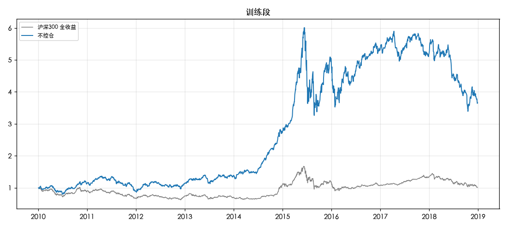
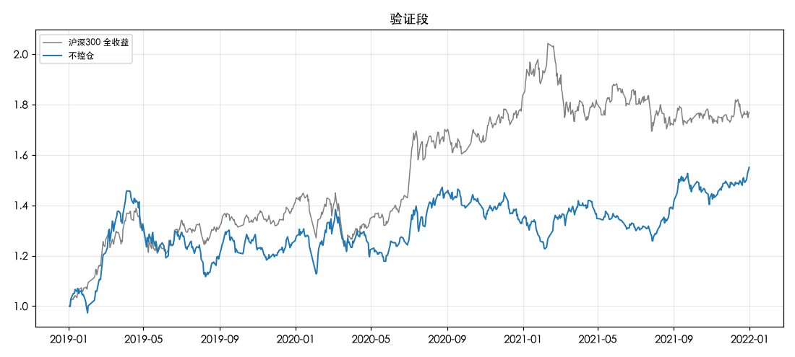

# 合成与仓位控制（全 A 主板）

规则见 `docs/DECISIONS.md` 2026-11-09。账户：10 万元、15 只、跌出前 45 名卖出、单股 20%、单行业 30%、止损 −20% 冷却 20 天；T 日收盘出信号、T+1 收盘成交。比较基准：沪深300 全收益指数（H00300）。

数据版本 `2026-10-25+local-20261101`。

## 仓位控制 A 的 6 个组合（都带回撤兜底 C）

挑选规则（2026-11-10 用户改）：训练段、验证段最大回撤分别不超过沪深300 全收益同期最大回撤的组合里，选验证段年化收益最高的；一个都达不到就停下来讨论，不放宽。原来的上限是固定 20%。

沪深300 全收益同期最大回撤：训练段 -46.1%，验证段 -17.1%。

| variant           | 训练段年化   | 训练段最大回撤   | 验证段最大回撤   | 验证段年化   | 两段都不超过沪深300同期回撤   | 选中   |
|:------------------|:-------------|:-----------------|:-----------------|:-------------|:------------------------------|:-------|
| A_120日_跌破后0%  | 11.0%        | -35.4%           | -36.6%           | -0.3%        | False                         | False  |
| A_120日_跌破后50% | 4.8%         | -56.9%           | -32.3%           | 8.4%         | False                         | False  |
| A_250日_跌破后0%  | 11.1%        | -25.0%           | -29.7%           | 3.8%         | False                         | False  |
| A_250日_跌破后50% | 8.8%         | -38.4%           | -27.6%           | 9.8%         | False                         | False  |
| A_60日_跌破后0%   | 10.6%        | -36.2%           | -33.4%           | 0.5%         | False                         | False  |
| A_60日_跌破后50%  | 9.2%         | -42.5%           | -36.6%           | 4.2%         | False                         | False  |

**没有组合在两段上回撤都不超过沪深300 同期最大回撤。按事先写定的规则停下来讨论，不放宽，也不跑后面的变体。**

## 全部方案

B 的目标波动率（训练段 20 日波动率中位数）：20.0%。名字里带「｜」的是选中组合上的只报告变体。

| 方案              | 段     | 年化   | 沪深300全收益   | 超额   | 最大回撤   | 沪深300同期最大回撤   | 波动   |   夏普 | 平均仓位   | 空仓天数占比   | 日均换手   | 年成本   |   止损次数 |   回撤兜底触发 |
|:------------------|:-------|:-------|:----------------|:-------|:-----------|:----------------------|:-------|-------:|:-----------|:---------------|:-----------|:---------|-----------:|---------------:|
| 不控仓            | 训练段 | 16.1%  | 0.2%            | 15.9%  | -45.7%     | -46.1%                | 26.3%  |   0.7  | 99.7%      | 0.0%           | 7.5%       | 7.4%     |         87 |              0 |
| A_60日_跌破后50%  | 训练段 | 9.2%   | 0.2%            | 9.0%   | -42.5%     | -46.1%                | 19.8%  |   0.54 | 79.6%      | 7.4%           | 6.3%       | 6.7%     |         29 |             11 |
| A_60日_跌破后0%   | 训练段 | 10.6%  | 0.2%            | 10.4%  | -36.2%     | -46.1%                | 15.6%  |   0.72 | 49.8%      | 44.7%          | 6.5%       | 6.7%     |          3 |              6 |
| A_120日_跌破后50% | 训练段 | 4.8%   | 0.2%            | 4.7%   | -56.9%     | -46.1%                | 19.7%  |   0.34 | 72.1%      | 20.4%          | 5.9%       | 6.2%     |         25 |             11 |
| A_120日_跌破后0%  | 训练段 | 11.0%  | 0.2%            | 10.8%  | -35.4%     | -46.1%                | 14.9%  |   0.77 | 46.5%      | 47.4%          | 5.5%       | 5.7%     |          4 |              5 |
| A_250日_跌破后50% | 训练段 | 8.8%   | 0.2%            | 8.6%   | -38.4%     | -46.1%                | 18.2%  |   0.56 | 64.7%      | 29.0%          | 5.1%       | 5.4%     |         27 |              8 |
| A_250日_跌破后0%  | 训练段 | 11.1%  | 0.2%            | 10.9%  | -25.0%     | -46.1%                | 15.2%  |   0.77 | 48.3%      | 48.8%          | 5.2%       | 5.4%     |          8 |              5 |
| B_波动率控制      | 训练段 | 6.0%   | 0.2%            | 5.8%   | -48.0%     | -46.1%                | 19.0%  |   0.4  | 78.8%      | 16.6%          | 6.0%       | 6.4%     |         39 |             10 |
| 不控仓            | 验证段 | 16.4%  | 21.8%           | -5.4%  | -23.4%     | -17.1%                | 21.0%  |   0.83 | 99.7%      | 0.0%           | 5.8%       | 6.1%     |         25 |              0 |
| A_60日_跌破后50%  | 验证段 | 4.2%   | 21.8%           | -17.6% | -36.6%     | -17.1%                | 20.4%  |   0.3  | 87.0%      | 2.9%           | 6.4%       | 7.0%     |         17 |              3 |
| A_60日_跌破后0%   | 验证段 | 0.5%   | 21.8%           | -21.3% | -33.4%     | -17.1%                | 17.7%  |   0.12 | 64.9%      | 34.6%          | 7.5%       | 8.5%     |          7 |              2 |
| A_120日_跌破后50% | 验证段 | 8.4%   | 21.8%           | -13.4% | -32.3%     | -17.1%                | 21.2%  |   0.49 | 92.0%      | 2.5%           | 6.5%       | 7.0%     |         19 |              2 |
| A_120日_跌破后0%  | 验证段 | -0.3%  | 21.8%           | -22.1% | -36.6%     | -17.1%                | 18.4%  |   0.08 | 75.6%      | 23.9%          | 7.7%       | 8.7%     |         12 |              2 |
| A_250日_跌破后50% | 验证段 | 9.8%   | 21.8%           | -12.0% | -27.6%     | -17.1%                | 15.5%  |   0.68 | 42.0%      | 56.0%          | 2.8%       | 3.0%     |          8 |              2 |
| A_250日_跌破后0%  | 验证段 | 3.8%   | 21.8%           | -18.0% | -29.7%     | -17.1%                | 14.1%  |   0.33 | 37.7%      | 62.1%          | 2.8%       | 3.2%     |          8 |              2 |
| B_波动率控制      | 验证段 | 8.6%   | 21.8%           | -13.2% | -30.1%     | -17.1%                | 17.0%  |   0.57 | 73.7%      | 23.9%          | 4.6%       | 4.9%     |         19 |              1 |

