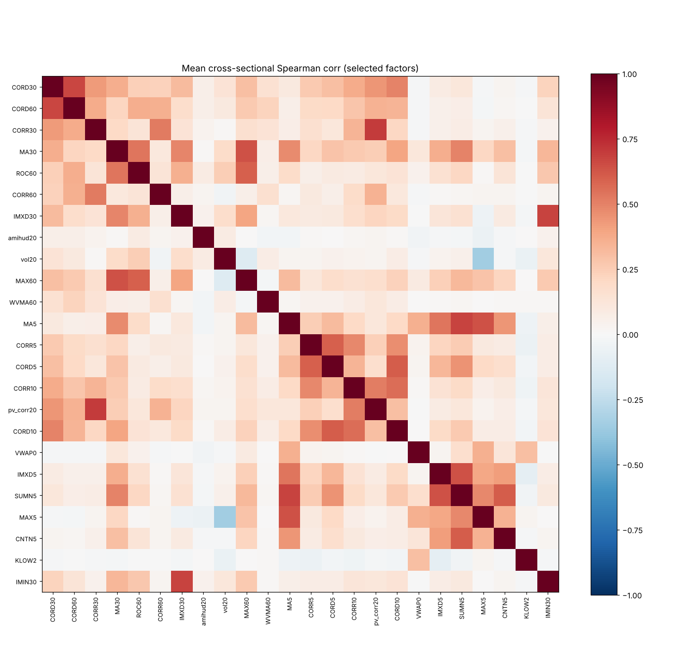

# 因子筛选与去冗余

- 样本：csi300 历史成分，train 段，行业和市值中性化后
- 候选：单因子检验里通过的因子（打分因子 29 个，排雷因子 33 个）
- 规则：两两相关性绝对值 > 0.7 的只留 ICIR 高的；先在打分因子里去冗余，再拿排雷因子和已留下的比
- 相关性：中性化、按方向调整后的因子值，每 5 个交易日一次的横截面 Spearman 相关，对时间取平均
- 结果：留下 24 个（打分因子 11 个，排雷因子 13 个），去掉 38 个；留下的因子之间相关性绝对值最大 0.70

## 最终名单

| factor    | 来源       | 分类     |   RankIC |   ICIR |    t 值 |   扣成本后 |   最低组 t 值 |
|:----------|:-----------|:---------|---------:|-------:|--------:|-----------:|--------------:|
| CORD30    | alpha158   | 打分因子 |   0.0413 | 0.4897 | 13.0063 |     0.0597 |       -5.1674 |
| CORD60    | alpha158   | 打分因子 |   0.0384 | 0.4704 | 12.4003 |     0.0767 |       -5.9112 |
| CORR30    | alpha158   | 打分因子 |   0.0285 | 0.3399 |  8.9549 |     0.0307 |       -4.7862 |
| MA30      | alpha158   | 打分因子 |   0.0401 | 0.3056 |  8.2162 |     0.0614 |       -3.2706 |
| ROC60     | alpha158   | 打分因子 |   0.0298 | 0.2235 |  5.8513 |     0.0455 |       -2.4454 |
| CORR60    | alpha158   | 打分因子 |   0.0196 | 0.2150 |  5.5212 |     0.0550 |       -2.7922 |
| IMXD30    | alpha158   | 打分因子 |   0.0190 | 0.1953 |  5.1127 |     0.0181 |       -2.2440 |
| amihud20  | literature | 打分因子 |   0.0154 | 0.1912 |  4.9649 |     0.0309 |       -2.9203 |
| vol20     | literature | 打分因子 |   0.0243 | 0.1752 |  4.6910 |     0.0207 |       -1.8593 |
| MAX60     | alpha158   | 打分因子 |   0.0183 | 0.1341 |  3.5021 |     0.0675 |       -2.2021 |
| WVMA60    | alpha158   | 打分因子 |   0.0103 | 0.1330 |  3.5165 |     0.0331 |       -2.0085 |
| MA5       | alpha158   | 排雷因子 |   0.0474 | 0.4356 | 14.1673 |    -0.1296 |       -4.8738 |
| CORR5     | alpha158   | 排雷因子 |   0.0296 | 0.3717 | 11.5571 |    -0.1412 |       -3.7902 |
| CORD5     | alpha158   | 排雷因子 |   0.0302 | 0.3705 | 11.0518 |    -0.0903 |       -3.2994 |
| CORR10    | alpha158   | 排雷因子 |   0.0310 | 0.3698 | 10.3748 |    -0.0262 |       -4.6870 |
| pv_corr20 | literature | 排雷因子 |   0.0302 | 0.3548 |  9.4860 |    -0.0026 |       -5.1075 |
| CORD10    | alpha158   | 排雷因子 |   0.0289 | 0.3353 |  9.2048 |    -0.0389 |       -4.7930 |
| VWAP0     | alpha158   | 排雷因子 |   0.0301 | 0.3198 | 14.2303 |    -0.3743 |       -3.7486 |
| IMXD5     | alpha158   | 排雷因子 |   0.0285 | 0.3036 |  9.3661 |    -0.1519 |       -3.9654 |
| SUMN5     | alpha158   | 排雷因子 |   0.0298 | 0.2787 |  8.1928 |    -0.1387 |       -4.1167 |
| MAX5      | alpha158   | 排雷因子 |   0.0226 | 0.2094 |  6.2698 |    -0.1021 |       -4.7268 |
| CNTN5     | alpha158   | 排雷因子 |   0.0158 | 0.1825 |  5.3946 |    -0.1216 |       -3.0749 |
| KLOW2     | alpha158   | 排雷因子 |   0.0110 | 0.1471 |  6.7670 |    -0.5440 |       -3.4161 |
| IMIN30    | alpha158   | 排雷因子 |   0.0119 | 0.1420 |  3.7860 |    -0.0589 |       -3.1278 |

## 去掉的因子

| factor   | 分类     | 被谁替代   |   相关系数 |   ICIR |
|:---------|:---------|:-----------|-----------:|-------:|
| CORD20   | 打分因子 | CORD30     |      0.780 |  0.421 |
| ROC30    | 打分因子 | MA30       |      0.811 |  0.305 |
| QTLU30   | 打分因子 | MA30       |      0.912 |  0.305 |
| MA20     | 打分因子 | MA30       |      0.924 |  0.304 |
| QTLD30   | 打分因子 | MA30       |      0.905 |  0.304 |
| QTLU20   | 打分因子 | MA30       |      0.823 |  0.300 |
| MA60     | 打分因子 | MA30       |      0.834 |  0.292 |
| ROC20    | 打分因子 | MA30       |      0.916 |  0.286 |
| rev20    | 打分因子 | MA30       |      0.915 |  0.286 |
| QTLD60   | 打分因子 | MA30       |      0.792 |  0.281 |
| RESI60   | 打分因子 | MA30       |      0.721 |  0.273 |
| QTLU60   | 打分因子 | MA30       |      0.801 |  0.269 |
| BETA30   | 打分因子 | MA30       |      0.773 |  0.207 |
| SUMN60   | 打分因子 | ROC60      |      0.913 |  0.158 |
| SUMD60   | 打分因子 | ROC60      |      0.913 |  0.158 |
| SUMP60   | 打分因子 | ROC60      |      0.913 |  0.158 |
| MAX30    | 打分因子 | MA30       |      0.704 |  0.148 |
| BETA60   | 打分因子 | ROC60      |      0.869 |  0.134 |
| QTLD5    | 排雷因子 | MA5        |      0.905 |  0.418 |
| BETA5    | 排雷因子 | MA5        |      0.872 |  0.413 |
| QTLU5    | 排雷因子 | MA5        |      0.901 |  0.403 |
| RANK5    | 排雷因子 | MA5        |      0.744 |  0.397 |
| ROC5     | 排雷因子 | MA5        |      0.764 |  0.389 |
| MA10     | 排雷因子 | MA5        |      0.808 |  0.377 |
| QTLU10   | 排雷因子 | MA5        |      0.796 |  0.368 |
| CORR20   | 排雷因子 | pv_corr20  |      1.000 |  0.355 |
| RESI10   | 排雷因子 | MA5        |      0.738 |  0.345 |
| RANK10   | 排雷因子 | MA5        |      0.713 |  0.338 |
| RSV5     | 排雷因子 | MA5        |      0.787 |  0.313 |
| IMIN5    | 排雷因子 | IMXD5      |      0.716 |  0.294 |
| RESI20   | 排雷因子 | MA5        |      0.755 |  0.279 |
| SUMD5    | 排雷因子 | SUMN5      |      1.000 |  0.278 |
| SUMP5    | 排雷因子 | SUMN5      |      1.000 |  0.278 |
| RANK20   | 排雷因子 | MA30       |      0.714 |  0.250 |
| IMAX5    | 排雷因子 | IMXD5      |      0.799 |  0.233 |
| RANK30   | 排雷因子 | MA30       |      0.794 |  0.227 |
| CNTP5    | 排雷因子 | CNTN5      |      0.734 |  0.147 |
| MAX10    | 排雷因子 | MAX5       |      0.759 |  0.127 |

全部候选之间的相关系数在 `candidate_corr.csv`；最终名单在 `selected.csv`，第 5 个 PR 的因子合成从这里读。
