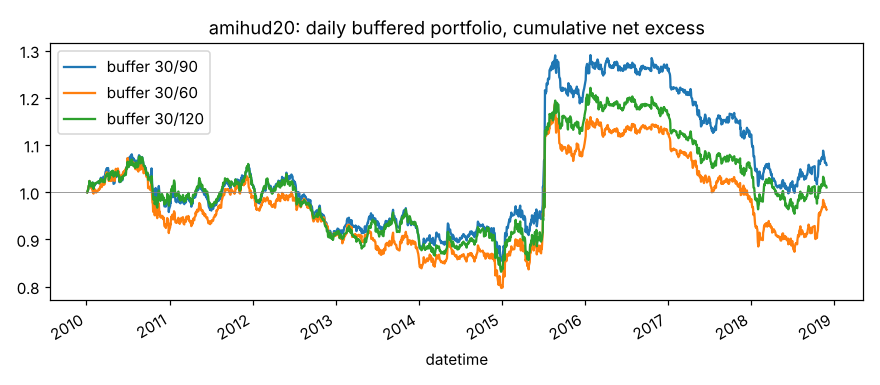

# amihud20

20 日平均 |日收益| / 成交额（非流动性）。来源：Amihud (2002)；Leippold, Wang, Zhou (2022)。

- 表达式：`Mean(Abs(($close/Ref($close,1)-1))/$amount,20)`
- 方向：+1（越大越好），依据：训练段实际 RankIC
- 样本：csi300 历史成分，train 段 2010-01-01 ~ 2018-11-29（段尾去掉 21 个交易日），2166 个交易日；能买入的样本占 94.0%；未做行业和市值中性化

## 结论：淘汰

作为打分因子：

- ❌ t 值 > 3
- ✅ 方向反了的年份不超过一半
- ✅ 按实际交易规则（30/90）扣成本后做多超额 > 0

作为排雷因子：

- ❌ t 值 > 3
- ✅ 方向反了的年份不超过一半
- ✅ 最低组年化超额 < 0
- ❌ 最低组超额 t 值 < -3

## IC（已按方向调整，正数表示和预期方向一致）

|       |   RankIC 均值 |   标准差 |   ICIR |   IC>0 占比 |   t 值（NW） |   天数 |
|:------|--------------:|---------:|-------:|------------:|-------------:|-------:|
| 1 天  |        0.0031 |   0.1502 | 0.0209 |      0.5141 |       0.9740 |   2165 |
| 2 天  |        0.0039 |   0.1582 | 0.0244 |      0.5072 |       0.9149 |   2165 |
| 3 天  |        0.0055 |   0.1618 | 0.0339 |      0.5132 |       1.0746 |   2165 |
| 5 天  |        0.0081 |   0.1647 | 0.0489 |      0.5164 |       1.2364 |   2165 |
| 10 天 |        0.0099 |   0.1678 | 0.0588 |      0.5196 |       1.0585 |   2165 |
| 20 天 |        0.0093 |   0.1674 | 0.0558 |      0.5381 |       0.7374 |   2165 |

- Pearson IC（5 天，去极值和标准化之后）：0.0086，t 值 1.59
- 回归法（5 天远期收益对标准化因子做横截面回归）：因子收益率均值 0.00021，t 值 0.77。只作参考，不设门槛

## 分年度

方向反了的年份占比：44%

|   年份 |   RankIC 均值 |
|-------:|--------------:|
|   2010 |        0.0169 |
|   2011 |        0.0056 |
|   2012 |       -0.0030 |
|   2013 |       -0.0066 |
|   2014 |        0.0007 |
|   2015 |        0.0715 |
|   2016 |        0.0191 |
|   2017 |       -0.0291 |
|   2018 |       -0.0037 |

## 分层（每 5 个交易日一次、互不重叠，5 组）

只用来看信号质量和单调性，不扣成本。

|         |   年化超额（相对等权全体） |
|:--------|---------------------------:|
| 第 1 组 |                     -4.11% |
| 第 2 组 |                     -1.69% |
| 第 3 组 |                      1.78% |
| 第 4 组 |                      3.00% |
| 第 5 组 |                      1.10% |

- 单调性（组号与平均超额的 Spearman 相关）：0.70
- 最低组年化超额 -4.11%，t 值 -1.15

## 按实际交易规则模拟

每天调仓，持仓 30 只等权；排名进前 30 才买，已持有的排名掉出缓冲线才卖。
买不进（入场日停牌或涨停）跳过，卖不掉（入场日停牌或跌停）继续持有。
成本：买入 0.125%，卖出佣金 + 印花税 + 滑点（docs/DECISIONS.md），最低 5 元佣金不计。
超额默认相对当天有打分、且第二天能买进的股票等权平均（筛选门槛用这个）；
最后一列相对所有有打分的股票，包括第二天涨停买不进的，作参考。两者都不是相对沪深300 指数。

|             |   日均单边换手 |   年化超额（扣成本前） |   年化成本 |   年化超额（扣成本后） |   扣成本后 t 值 |   扣成本后（参考：全体基准） |
|:------------|---------------:|-----------------------:|-----------:|-----------------------:|----------------:|-----------------------------:|
| 缓冲 30/90  |         0.0074 |                 0.0168 |     0.0067 |                 0.0102 |          0.3475 |                      -0.0365 |
| 缓冲 30/60  |         0.0114 |                 0.0098 |     0.0102 |                -0.0005 |         -0.0152 |                      -0.0472 |
| 缓冲 30/120 |         0.0059 |                 0.0101 |     0.0053 |                 0.0048 |          0.1641 |                      -0.0419 |

