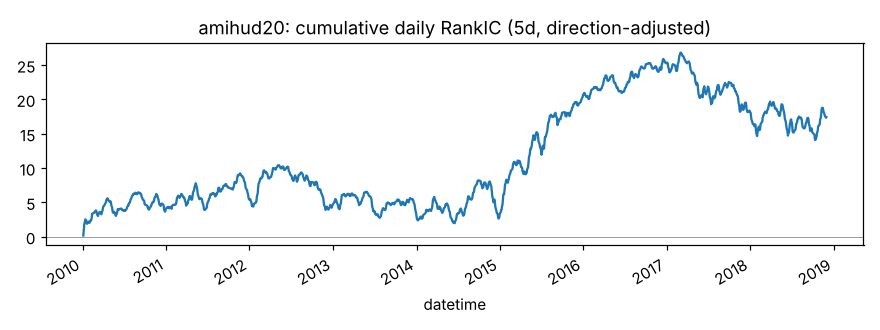
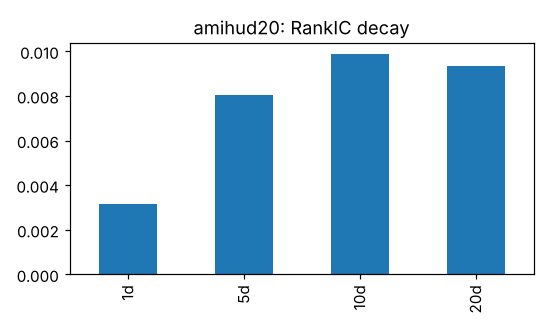
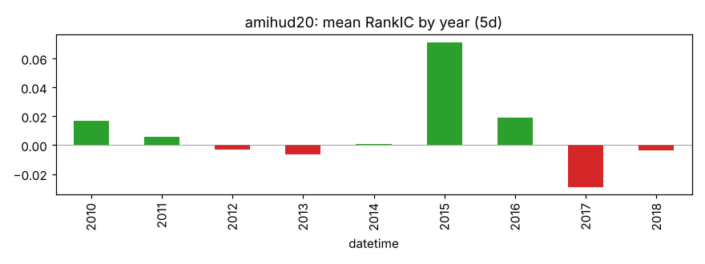
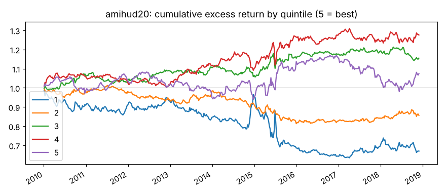

# amihud20

20 日平均 |日收益| / 成交额（非流动性）。来源：Amihud (2002)；Leippold, Wang, Zhou (2022)。

- 表达式：`Mean(Abs(($close/Ref($close,1)-1))/$amount,20)`
- 方向：+1（越大越好），依据：训练段实际 RankIC
- 样本：csi300 历史成分，train 段 2010-01-01 ~ 2018-11-29（段尾去掉 21 个交易日），2166 个交易日，过滤后保留 94.0% 的样本；未做行业和市值中性化

## 结论：未通过

- ❌ t 值 > 3
- ✅ 方向反了的年份不超过一半
- ❌ 扣成本后做多一侧超额 > 0

## IC（已按方向调整，正数表示和预期方向一致）

|       |   RankIC 均值 |   标准差 |   ICIR |   IC>0 占比 |   t 值（NW） |   天数 |
|:------|--------------:|---------:|-------:|------------:|-------------:|-------:|
| 1 天  |        0.0031 |   0.1502 | 0.0209 |      0.5141 |       0.9740 |   2165 |
| 5 天  |        0.0081 |   0.1647 | 0.0489 |      0.5164 |       1.2364 |   2165 |
| 10 天 |        0.0099 |   0.1678 | 0.0588 |      0.5196 |       1.0585 |   2165 |
| 20 天 |        0.0093 |   0.1674 | 0.0558 |      0.5381 |       0.7374 |   2165 |

Pearson IC（5 天，去极值和标准化之后）：0.0086，t 值 1.59。

## 分年度

方向反了的年份占比：44%

|   年份 |   RankIC 均值 |
|-------:|--------------:|
|   2010 |        0.0169 |
|   2011 |        0.0056 |
|   2012 |       -0.0030 |
|   2013 |       -0.0066 |
|   2014 |        0.0007 |
|   2015 |        0.0715 |
|   2016 |        0.0191 |
|   2017 |       -0.0291 |
|   2018 |       -0.0037 |

## 分层（每 5 个交易日调仓，5 组）

|         |   年化超额（相对等权全体） |
|:--------|---------------------------:|
| 第 1 组 |                     -4.11% |
| 第 2 组 |                     -1.69% |
| 第 3 组 |                      1.78% |
| 第 4 组 |                      3.00% |
| 第 5 组 |                      1.10% |

单调性（组号与平均超额的 Spearman 相关）：0.70

## 换手与成本

- 最高组每期换手率：12.1%
- 最高组年化超额（扣成本前）：1.10%
- 最高组年化超额（扣成本后）：-1.07%

成本按 docs/DECISIONS.md：买入 0.125%，卖出佣金 + 印花税 + 滑点，最低 5 元佣金不计。
超额是相对同期全体样本等权平均收益，不是相对沪深300 指数。
