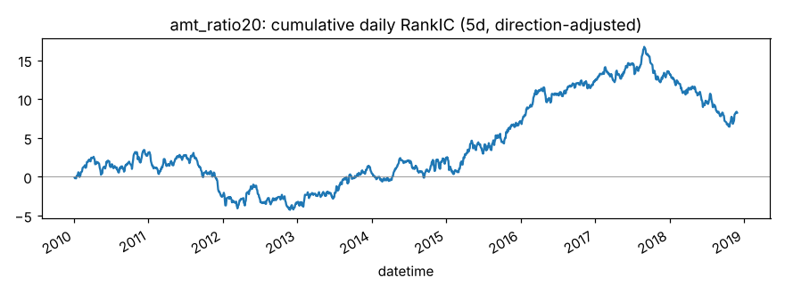
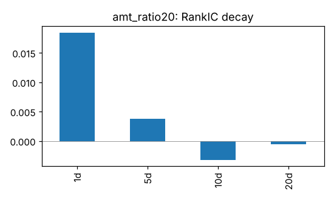
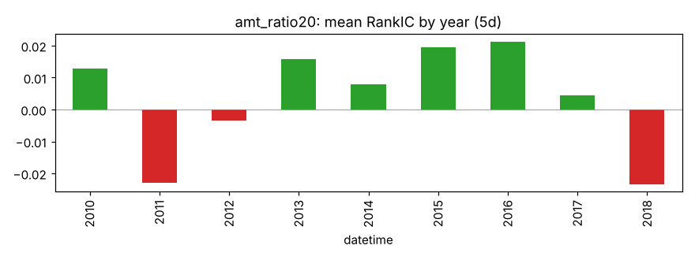
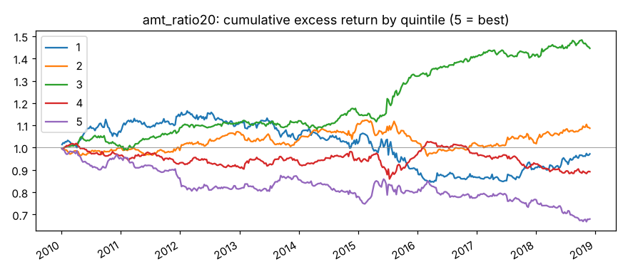

# amt_ratio20

当日成交额 / 20 日均值（换手率异常的近似，数据包里没有流通股本）。来源：换手率效应。

- 表达式：`$amount/Mean($amount,20)`
- 方向：-1（越小越好），依据：文献
- 样本：csi300 历史成分，train 段 2010-01-01 ~ 2018-11-29（段尾去掉 21 个交易日），2166 个交易日，过滤后保留 94.0% 的样本；未做行业和市值中性化

## 结论：未通过

- ❌ t 值 > 3
- ✅ 方向反了的年份不超过一半
- ❌ 扣成本后做多一侧超额 > 0

## IC（已按方向调整，正数表示和预期方向一致）

|       |   RankIC 均值 |   标准差 |    ICIR |   IC>0 占比 |   t 值（NW） |   天数 |
|:------|--------------:|---------:|--------:|------------:|-------------:|-------:|
| 1 天  |        0.0184 |   0.1485 |  0.1241 |      0.5561 |       5.7765 |   2165 |
| 5 天  |        0.0038 |   0.1413 |  0.0269 |      0.5173 |       0.8612 |   2165 |
| 10 天 |       -0.0032 |   0.1374 | -0.0236 |      0.4887 |      -0.6022 |   2165 |
| 20 天 |       -0.0005 |   0.1393 | -0.0037 |      0.4984 |      -0.0793 |   2165 |

Pearson IC（5 天，去极值和标准化之后）：0.0013，t 值 0.32。

## 分年度

方向反了的年份占比：33%

|   年份 |   RankIC 均值 |
|-------:|--------------:|
|   2010 |        0.0129 |
|   2011 |       -0.0229 |
|   2012 |       -0.0034 |
|   2013 |        0.0158 |
|   2014 |        0.0080 |
|   2015 |        0.0194 |
|   2016 |        0.0213 |
|   2017 |        0.0044 |
|   2018 |       -0.0235 |

## 分层（每 5 个交易日调仓，5 组）

|         |   年化超额（相对等权全体） |
|:--------|---------------------------:|
| 第 1 组 |                     -0.03% |
| 第 2 组 |                      1.09% |
| 第 3 组 |                      4.38% |
| 第 4 组 |                     -1.19% |
| 第 5 组 |                     -4.22% |

单调性（组号与平均超额的 Spearman 相关）：-0.60

## 换手与成本

- 最高组每期换手率：68.0%
- 最高组年化超额（扣成本前）：-4.22%
- 最高组年化超额（扣成本后）：-16.22%

成本按 docs/DECISIONS.md：买入 0.125%，卖出佣金 + 印花税 + 滑点，最低 5 元佣金不计。
超额是相对同期全体样本等权平均收益，不是相对沪深300 指数。
