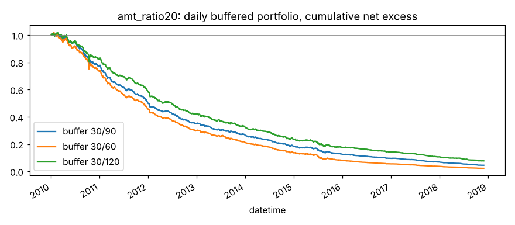

# amt_ratio20

当日成交额 / 20 日均值（换手率异常的近似，数据包里没有流通股本）。来源：换手率效应。

- 表达式：`$amount/Mean($amount,20)`
- 方向：-1（越小越好），依据：文献
- 样本：csi300 历史成分，train 段 2010-01-01 ~ 2018-11-29（段尾去掉 21 个交易日），2166 个交易日；能买入的样本占 94.0%；未做行业和市值中性化

## 结论：淘汰

作为打分因子：

- ❌ t 值 > 3
- ✅ 方向反了的年份不超过一半
- ❌ 按实际交易规则（30/90）扣成本后做多超额 > 0

作为排雷因子：

- ❌ t 值 > 3
- ✅ 方向反了的年份不超过一半
- ✅ 最低组年化超额 < 0
- ❌ 最低组超额 t 值 < -3

## IC（已按方向调整，正数表示和预期方向一致）

|       |   RankIC 均值 |   标准差 |    ICIR |   IC>0 占比 |   t 值（NW） |   天数 |
|:------|--------------:|---------:|--------:|------------:|-------------:|-------:|
| 1 天  |        0.0184 |   0.1485 |  0.1241 |      0.5561 |       5.7765 |   2165 |
| 2 天  |        0.0125 |   0.1449 |  0.0861 |      0.5395 |       3.5619 |   2165 |
| 3 天  |        0.0097 |   0.1435 |  0.0673 |      0.5233 |       2.4577 |   2165 |
| 5 天  |        0.0038 |   0.1413 |  0.0269 |      0.5173 |       0.8612 |   2165 |
| 10 天 |       -0.0032 |   0.1374 | -0.0236 |      0.4887 |      -0.6022 |   2165 |
| 20 天 |       -0.0005 |   0.1393 | -0.0037 |      0.4984 |      -0.0793 |   2165 |

- Pearson IC（5 天，去极值和标准化之后）：0.0013，t 值 0.32
- 回归法（5 天远期收益对标准化因子做横截面回归）：因子收益率均值 -0.00008，t 值 -0.39。只作参考，不设门槛

## 分年度

方向反了的年份占比：33%

|   年份 |   RankIC 均值 |
|-------:|--------------:|
|   2010 |        0.0129 |
|   2011 |       -0.0229 |
|   2012 |       -0.0034 |
|   2013 |        0.0158 |
|   2014 |        0.0080 |
|   2015 |        0.0194 |
|   2016 |        0.0213 |
|   2017 |        0.0044 |
|   2018 |       -0.0235 |

## 分层（每 5 个交易日一次、互不重叠，5 组）

只用来看信号质量和单调性，不扣成本。

|         |   年化超额（相对等权全体） |
|:--------|---------------------------:|
| 第 1 组 |                     -0.03% |
| 第 2 组 |                      1.09% |
| 第 3 组 |                      4.38% |
| 第 4 组 |                     -1.19% |
| 第 5 组 |                     -4.22% |

- 单调性（组号与平均超额的 Spearman 相关）：-0.60
- 最低组年化超额 -0.03%，t 值 -0.01

## 按实际交易规则模拟

每天调仓，持仓 30 只等权；排名进前 30 才买，已持有的排名掉出缓冲线才卖。
买不进（入场日停牌或涨停）跳过，卖不掉（入场日停牌或跌停）继续持有。
成本：买入 0.125%，卖出佣金 + 印花税 + 滑点（docs/DECISIONS.md），最低 5 元佣金不计。
超额是相对当天有打分的全体股票等权平均，不是相对沪深300 指数。

|             |   日均单边换手 |   年化超额（扣成本前） |   年化成本 |   年化超额（扣成本后） |   扣成本后 t 值 |
|:------------|---------------:|-----------------------:|-----------:|-----------------------:|----------------:|
| 缓冲 30/90  |         0.2868 |                -0.1045 |     0.2530 |                -0.3576 |        -12.6659 |
| 缓冲 30/60  |         0.3825 |                -0.1014 |     0.3374 |                -0.4387 |        -15.1536 |
| 缓冲 30/120 |         0.2216 |                -0.0993 |     0.1955 |                -0.2947 |        -10.7165 |

