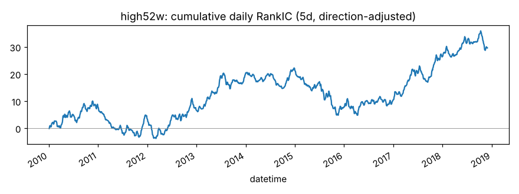
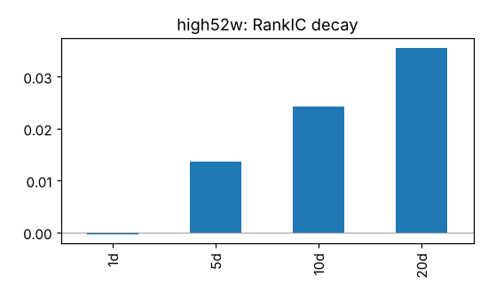
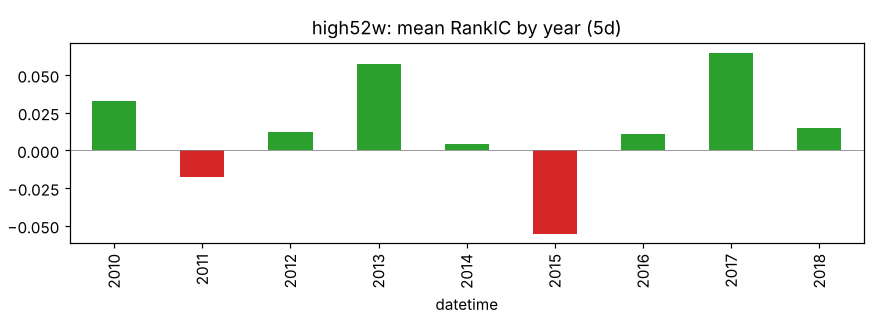
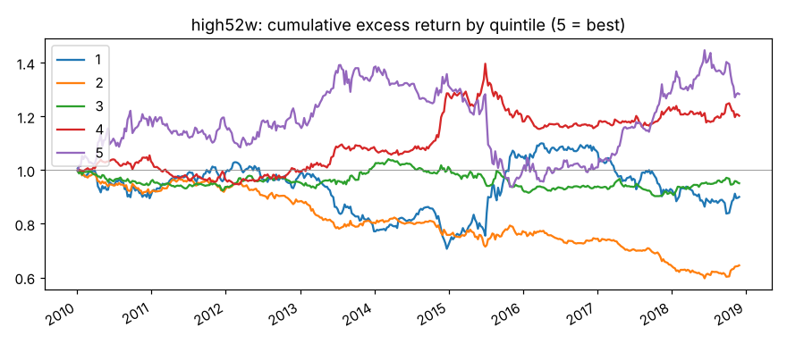

# high52w

收盘价 / 过去 250 日最高价（52 周新高）。来源：George & Hwang (2004)。

- 表达式：`$close/Max($high,250)`
- 方向：+1（越大越好），依据：文献
- 样本：csi300 历史成分，train 段 2010-01-01 ~ 2018-11-29（段尾去掉 21 个交易日），2166 个交易日，过滤后保留 94.0% 的样本；未做行业和市值中性化

## 结论：未通过

- ❌ t 值 > 3
- ✅ 方向反了的年份不超过一半
- ❌ 扣成本后做多一侧超额 > 0

## IC（已按方向调整，正数表示和预期方向一致）

|       |   RankIC 均值 |   标准差 |    ICIR |   IC>0 占比 |   t 值（NW） |   天数 |
|:------|--------------:|---------:|--------:|------------:|-------------:|-------:|
| 1 天  |       -0.0003 |   0.2226 | -0.0016 |      0.5104 |      -0.0729 |   2165 |
| 5 天  |        0.0137 |   0.2339 |  0.0585 |      0.5335 |       1.5104 |   2165 |
| 10 天 |        0.0243 |   0.2347 |  0.1035 |      0.5492 |       1.8853 |   2165 |
| 20 天 |        0.0356 |   0.2383 |  0.1492 |      0.5432 |       1.9084 |   2165 |

Pearson IC（5 天，去极值和标准化之后）：0.0104，t 值 1.23。

## 分年度

方向反了的年份占比：22%

|   年份 |   RankIC 均值 |
|-------:|--------------:|
|   2010 |        0.0330 |
|   2011 |       -0.0174 |
|   2012 |        0.0120 |
|   2013 |        0.0571 |
|   2014 |        0.0045 |
|   2015 |       -0.0554 |
|   2016 |        0.0107 |
|   2017 |        0.0650 |
|   2018 |        0.0148 |

## 分层（每 5 个交易日调仓，5 组）

|         |   年化超额（相对等权全体） |
|:--------|---------------------------:|
| 第 1 组 |                     -0.61% |
| 第 2 组 |                     -4.91% |
| 第 3 组 |                     -0.48% |
| 第 4 组 |                      2.33% |
| 第 5 组 |                      3.61% |

单调性（组号与平均超额的 Spearman 相关）：0.90

## 换手与成本

- 最高组每期换手率：20.9%
- 最高组年化超额（扣成本前）：3.61%
- 最高组年化超额（扣成本后）：-0.10%

成本按 docs/DECISIONS.md：买入 0.125%，卖出佣金 + 印花税 + 滑点，最低 5 元佣金不计。
超额是相对同期全体样本等权平均收益，不是相对沪深300 指数。
