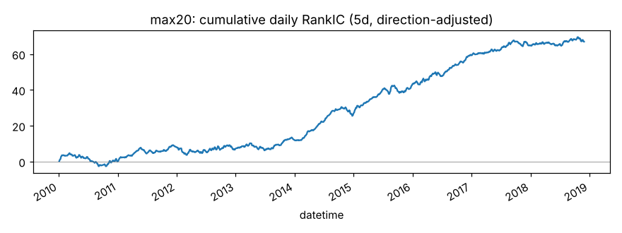
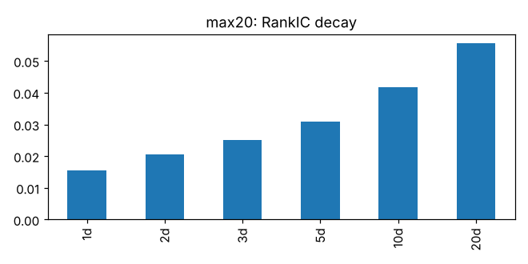
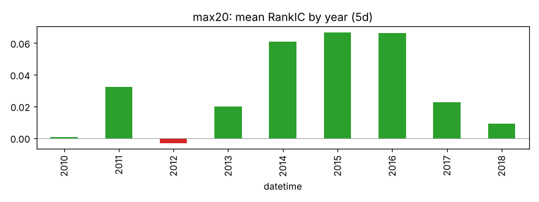
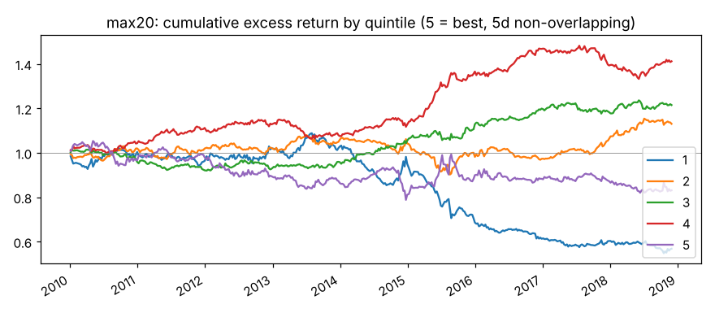
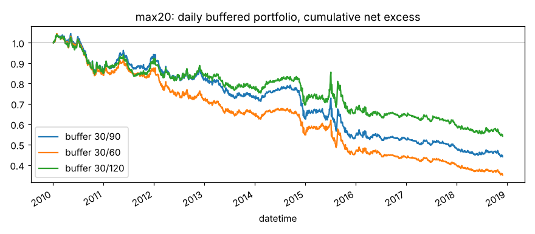

# max20

20 日内最大单日收益（彩票效应）。来源：Bali, Cakici, Whitelaw (2011)。

- 表达式：`Max(($close/Ref($close,1)-1),20)`
- 方向：-1（越小越好），依据：文献
- 样本：csi300 历史成分，train 段 2010-01-01 ~ 2018-11-29（段尾去掉 21 个交易日），2166 个交易日；能买入的样本占 94.0%；未做行业和市值中性化

## 结论：淘汰

作为打分因子：

- ✅ t 值 > 3
- ✅ 方向反了的年份不超过一半
- ❌ 按实际交易规则（30/90）扣成本后做多超额 > 0

作为排雷因子：

- ✅ t 值 > 3
- ✅ 方向反了的年份不超过一半
- ✅ 最低组年化超额 < 0
- ❌ 最低组超额 t 值 < -3

## IC（已按方向调整，正数表示和预期方向一致）

|       |   RankIC 均值 |   标准差 |   ICIR |   IC>0 占比 |   t 值（NW） |   天数 |
|:------|--------------:|---------:|-------:|------------:|-------------:|-------:|
| 1 天  |        0.0156 |   0.1857 | 0.0842 |      0.5460 |       3.9185 |   2165 |
| 2 天  |        0.0205 |   0.1813 | 0.1132 |      0.5589 |       4.4481 |   2165 |
| 3 天  |        0.0252 |   0.1769 | 0.1425 |      0.5654 |       4.7792 |   2165 |
| 5 天  |        0.0309 |   0.1729 | 0.1788 |      0.5774 |       4.8362 |   2165 |
| 10 天 |        0.0417 |   0.1657 | 0.2515 |      0.5991 |       4.7940 |   2165 |
| 20 天 |        0.0555 |   0.1687 | 0.3291 |      0.6374 |       4.5647 |   2165 |

- Pearson IC（5 天，去极值和标准化之后）：0.0118，t 值 2.03
- 回归法（5 天远期收益对标准化因子做横截面回归）：因子收益率均值 0.00048，t 值 1.69。只作参考，不设门槛

## 分年度

方向反了的年份占比：11%

|   年份 |   RankIC 均值 |
|-------:|--------------:|
|   2010 |        0.0005 |
|   2011 |        0.0325 |
|   2012 |       -0.0033 |
|   2013 |        0.0201 |
|   2014 |        0.0608 |
|   2015 |        0.0669 |
|   2016 |        0.0662 |
|   2017 |        0.0228 |
|   2018 |        0.0092 |

## 分层（每 5 个交易日一次、互不重叠，5 组）

只用来看信号质量和单调性，不扣成本。

|         |   年化超额（相对等权全体） |
|:--------|---------------------------:|
| 第 1 组 |                     -6.21% |
| 第 2 组 |                      1.58% |
| 第 3 组 |                      2.36% |
| 第 4 组 |                      4.11% |
| 第 5 组 |                     -1.79% |

- 单调性（组号与平均超额的 Spearman 相关）：0.40
- 最低组年化超额 -6.21%，t 值 -2.18

## 按实际交易规则模拟

每天调仓，持仓 30 只等权；排名进前 30 才买，已持有的排名掉出缓冲线才卖。
买不进（入场日停牌或涨停）跳过，卖不掉（入场日停牌或跌停）继续持有。
成本：买入 0.125%，卖出佣金 + 印花税 + 滑点（docs/DECISIONS.md），最低 5 元佣金不计。
超额是相对当天有打分的全体股票等权平均，不是相对沪深300 指数。

|             |   日均单边换手 |   年化超额（扣成本前） |   年化成本 |   年化超额（扣成本后） |   扣成本后 t 值 |
|:------------|---------------:|-----------------------:|-----------:|-----------------------:|----------------:|
| 缓冲 30/90  |         0.0362 |                -0.0568 |     0.0320 |                -0.0889 |         -2.2828 |
| 缓冲 30/60  |         0.0527 |                -0.0689 |     0.0466 |                -0.1155 |         -2.9998 |
| 缓冲 30/120 |         0.0263 |                -0.0417 |     0.0233 |                -0.0650 |         -1.6834 |

