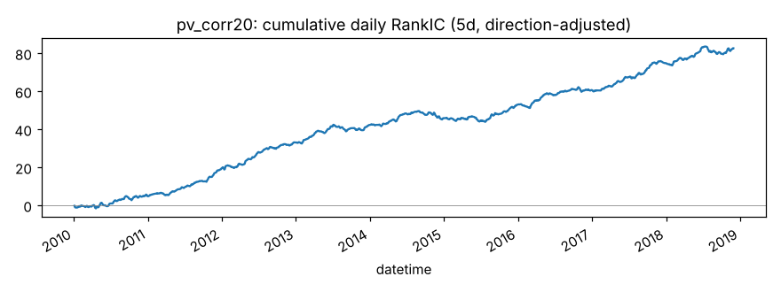
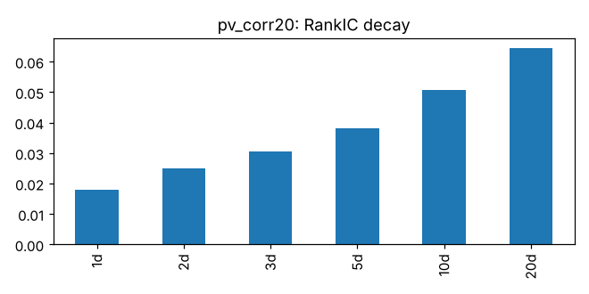
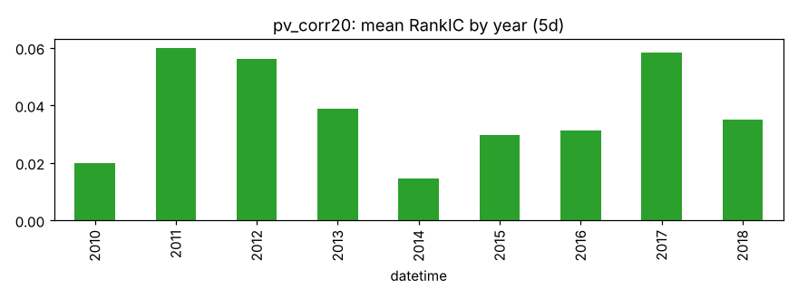
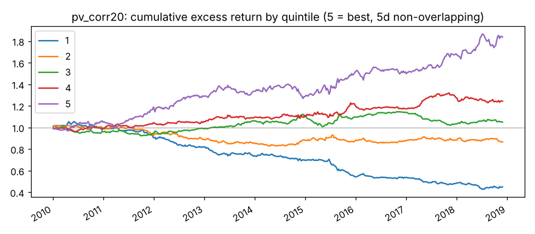
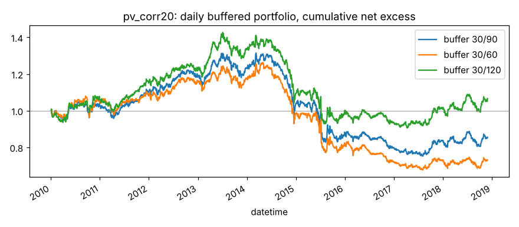

# pv_corr20

20 日收盘价与对数成交量的相关性。来源：Alpha158 CORR 类。

- 表达式：`Corr($close,Log($volume+1),20)`
- 方向：-1（越小越好），依据：训练段实际 RankIC
- 样本：csi300 历史成分，train 段 2010-01-01 ~ 2018-11-29（段尾去掉 21 个交易日），2166 个交易日；能买入的样本占 94.0%；未做行业和市值中性化

## 结论：排雷因子

作为打分因子：

- ✅ t 值 > 3
- ✅ 方向反了的年份不超过一半
- ❌ 按实际交易规则（30/90）扣成本后做多超额 > 0

作为排雷因子：

- ✅ t 值 > 3
- ✅ 方向反了的年份不超过一半
- ✅ 最低组年化超额 < 0
- ✅ 最低组超额 t 值 < -3

## IC（已按方向调整，正数表示和预期方向一致）

|       |   RankIC 均值 |   标准差 |   ICIR |   IC>0 占比 |   t 值（NW） |   天数 |
|:------|--------------:|---------:|-------:|------------:|-------------:|-------:|
| 1 天  |        0.0181 |   0.1423 | 0.1270 |      0.5487 |       5.9099 |   2165 |
| 2 天  |        0.0250 |   0.1424 | 0.1753 |      0.5723 |       6.6993 |   2165 |
| 3 天  |        0.0306 |   0.1438 | 0.2127 |      0.5824 |       6.9039 |   2165 |
| 5 天  |        0.0382 |   0.1442 | 0.2648 |      0.6023 |       6.9796 |   2165 |
| 10 天 |        0.0508 |   0.1477 | 0.3439 |      0.6346 |       6.6217 |   2165 |
| 20 天 |        0.0643 |   0.1415 | 0.4544 |      0.6702 |       6.3972 |   2165 |

- Pearson IC（5 天，去极值和标准化之后）：0.0289，t 值 5.52
- 回归法（5 天远期收益对标准化因子做横截面回归）：因子收益率均值 0.00102，t 值 4.07。只作参考，不设门槛

## 分年度

方向反了的年份占比：0%

|   年份 |   RankIC 均值 |
|-------:|--------------:|
|   2010 |        0.0198 |
|   2011 |        0.0599 |
|   2012 |        0.0562 |
|   2013 |        0.0387 |
|   2014 |        0.0147 |
|   2015 |        0.0295 |
|   2016 |        0.0312 |
|   2017 |        0.0584 |
|   2018 |        0.0350 |

## 分层（每 5 个交易日一次、互不重叠，5 组）

只用来看信号质量和单调性，不扣成本。

|         |   年化超额（相对等权全体） |
|:--------|---------------------------:|
| 第 1 组 |                     -9.05% |
| 第 2 组 |                     -1.57% |
| 第 3 组 |                      0.66% |
| 第 4 组 |                      2.65% |
| 第 5 组 |                      7.35% |

- 单调性（组号与平均超额的 Spearman 相关）：1.00
- 最低组年化超额 -9.05%，t 值 -4.06

## 按实际交易规则模拟

每天调仓，持仓 30 只等权；排名进前 30 才买，已持有的排名掉出缓冲线才卖。
买不进（入场日停牌或涨停）跳过，卖不掉（入场日停牌或跌停）继续持有。
成本：买入 0.125%，卖出佣金 + 印花税 + 滑点（docs/DECISIONS.md），最低 5 元佣金不计。
超额是相对当天有打分的全体股票等权平均，不是相对沪深300 指数。

|             |   日均单边换手 |   年化超额（扣成本前） |   年化成本 |   年化超额（扣成本后） |   扣成本后 t 值 |
|:------------|---------------:|-----------------------:|-----------:|-----------------------:|----------------:|
| 缓冲 30/90  |         0.0619 |                 0.0412 |     0.0547 |                -0.0136 |         -0.4137 |
| 缓冲 30/60  |         0.0834 |                 0.0418 |     0.0736 |                -0.0318 |         -0.9628 |
| 缓冲 30/120 |         0.0501 |                 0.0561 |     0.0443 |                 0.0118 |          0.3718 |

