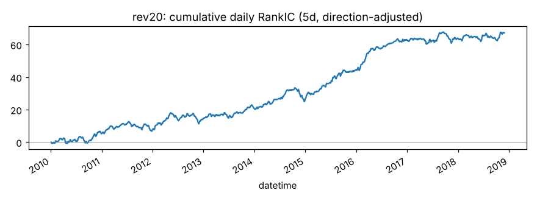
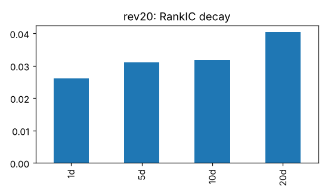
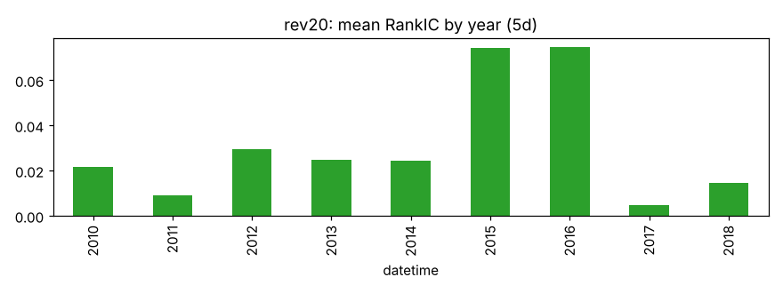
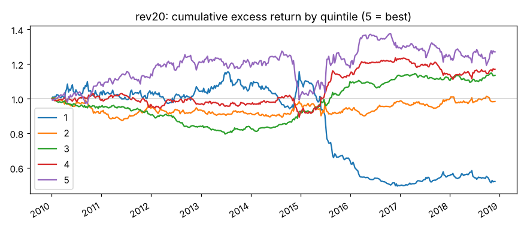

# rev20

过去 20 个交易日收益（短期反转）。来源：Chui, Subrahmanyam, Titman；Yue, Li, Ruan。

- 表达式：`$close/Ref($close,20)-1`
- 方向：-1（越小越好），依据：文献
- 样本：csi300 历史成分，train 段 2010-01-01 ~ 2018-11-29（段尾去掉 21 个交易日），2166 个交易日，过滤后保留 94.0% 的样本；未做行业和市值中性化

## 结论：未通过

- ✅ t 值 > 3
- ✅ 方向反了的年份不超过一半
- ❌ 扣成本后做多一侧超额 > 0

## IC（已按方向调整，正数表示和预期方向一致）

|       |   RankIC 均值 |   标准差 |   ICIR |   IC>0 占比 |   t 值（NW） |   天数 |
|:------|--------------:|---------:|-------:|------------:|-------------:|-------:|
| 1 天  |        0.0262 |   0.2170 | 0.1207 |      0.5427 |       5.6163 |   2165 |
| 5 天  |        0.0310 |   0.2106 | 0.1473 |      0.5543 |       3.9496 |   2165 |
| 10 天 |        0.0319 |   0.2073 | 0.1537 |      0.5520 |       2.9641 |   2165 |
| 20 天 |        0.0404 |   0.2046 | 0.1973 |      0.5649 |       2.7495 |   2165 |

Pearson IC（5 天，去极值和标准化之后）：0.0194，t 值 2.58。

## 分年度

方向反了的年份占比：0%

|   年份 |   RankIC 均值 |
|-------:|--------------:|
|   2010 |        0.0215 |
|   2011 |        0.0090 |
|   2012 |        0.0297 |
|   2013 |        0.0249 |
|   2014 |        0.0242 |
|   2015 |        0.0741 |
|   2016 |        0.0747 |
|   2017 |        0.0049 |
|   2018 |        0.0145 |

## 分层（每 5 个交易日调仓，5 组）

|         |   年化超额（相对等权全体） |
|:--------|---------------------------:|
| 第 1 组 |                     -6.87% |
| 第 2 组 |                     -0.01% |
| 第 3 组 |                      1.58% |
| 第 4 组 |                      2.01% |
| 第 5 组 |                      3.31% |

单调性（组号与平均超额的 Spearman 相关）：1.00

## 换手与成本

- 最高组每期换手率：44.0%
- 最高组年化超额（扣成本前）：3.31%
- 最高组年化超额（扣成本后）：-4.48%

成本按 docs/DECISIONS.md：买入 0.125%，卖出佣金 + 印花税 + 滑点，最低 5 元佣金不计。
超额是相对同期全体样本等权平均收益，不是相对沪深300 指数。
