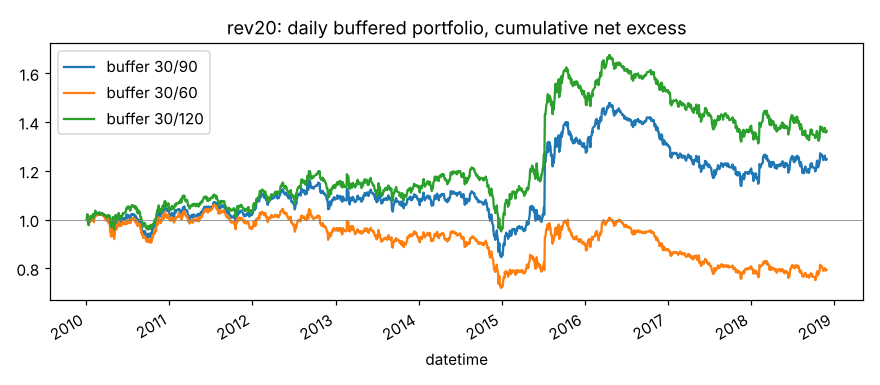

# rev20

过去 20 个交易日收益（短期反转）。来源：Chui, Subrahmanyam, Titman；Yue, Li, Ruan。

- 表达式：`$close/Ref($close,20)-1`
- 方向：-1（越小越好），依据：文献
- 样本：csi300 历史成分，train 段 2010-01-01 ~ 2018-11-29（段尾去掉 21 个交易日），2166 个交易日；能买入的样本占 94.0%；未做行业和市值中性化

## 结论：打分因子

作为打分因子：

- ✅ t 值 > 3
- ✅ 方向反了的年份不超过一半
- ✅ 按实际交易规则（30/90）扣成本后做多超额 > 0

作为排雷因子：

- ✅ t 值 > 3
- ✅ 方向反了的年份不超过一半
- ✅ 最低组年化超额 < 0
- ❌ 最低组超额 t 值 < -3

## IC（已按方向调整，正数表示和预期方向一致）

|       |   RankIC 均值 |   标准差 |   ICIR |   IC>0 占比 |   t 值（NW） |   天数 |
|:------|--------------:|---------:|-------:|------------:|-------------:|-------:|
| 1 天  |        0.0262 |   0.2170 | 0.1207 |      0.5427 |       5.6163 |   2165 |
| 2 天  |        0.0283 |   0.2143 | 0.1320 |      0.5450 |       5.0579 |   2165 |
| 3 天  |        0.0313 |   0.2145 | 0.1459 |      0.5469 |       4.8059 |   2165 |
| 5 天  |        0.0310 |   0.2106 | 0.1473 |      0.5543 |       3.9496 |   2165 |
| 10 天 |        0.0319 |   0.2073 | 0.1537 |      0.5520 |       2.9641 |   2165 |
| 20 天 |        0.0404 |   0.2046 | 0.1973 |      0.5649 |       2.7495 |   2165 |

- Pearson IC（5 天，去极值和标准化之后）：0.0194，t 值 2.58
- 回归法（5 天远期收益对标准化因子做横截面回归）：因子收益率均值 0.00068，t 值 1.86。只作参考，不设门槛

## 分年度

方向反了的年份占比：0%

|   年份 |   RankIC 均值 |
|-------:|--------------:|
|   2010 |        0.0215 |
|   2011 |        0.0090 |
|   2012 |        0.0297 |
|   2013 |        0.0249 |
|   2014 |        0.0242 |
|   2015 |        0.0741 |
|   2016 |        0.0747 |
|   2017 |        0.0049 |
|   2018 |        0.0145 |

## 分层（每 5 个交易日一次、互不重叠，5 组）

只用来看信号质量和单调性，不扣成本。

|         |   年化超额（相对等权全体） |
|:--------|---------------------------:|
| 第 1 组 |                     -6.87% |
| 第 2 组 |                     -0.01% |
| 第 3 组 |                      1.58% |
| 第 4 组 |                      2.01% |
| 第 5 组 |                      3.31% |

- 单调性（组号与平均超额的 Spearman 相关）：1.00
- 最低组年化超额 -6.87%，t 值 -1.73

## 按实际交易规则模拟

每天调仓，持仓 30 只等权；排名进前 30 才买，已持有的排名掉出缓冲线才卖。
买不进（入场日停牌或涨停）跳过，卖不掉（入场日停牌或跌停）继续持有。
成本：买入 0.125%，卖出佣金 + 印花税 + 滑点（docs/DECISIONS.md），最低 5 元佣金不计。
超额默认相对当天有打分、且第二天能买进的股票等权平均（筛选门槛用这个）；
最后一列相对所有有打分的股票，包括第二天涨停买不进的，作参考。两者都不是相对沪深300 指数。

|             |   日均单边换手 |   年化超额（扣成本前） |   年化成本 |   年化超额（扣成本后） |   扣成本后 t 值 |   扣成本后（参考：全体基准） |
|:------------|---------------:|-----------------------:|-----------:|-----------------------:|----------------:|-----------------------------:|
| 缓冲 30/90  |         0.0752 |                 0.0990 |     0.0664 |                 0.0326 |          0.8135 |                      -0.0081 |
| 缓冲 30/60  |         0.0996 |                 0.0679 |     0.0879 |                -0.0200 |         -0.4990 |                      -0.0606 |
| 缓冲 30/120 |         0.0621 |                 0.0973 |     0.0549 |                 0.0424 |          1.1081 |                       0.0017 |

