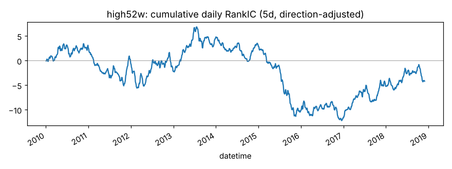
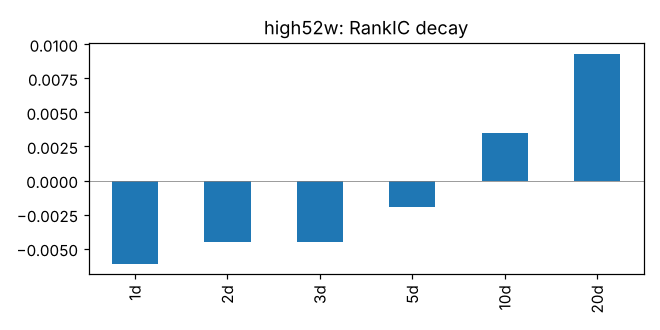
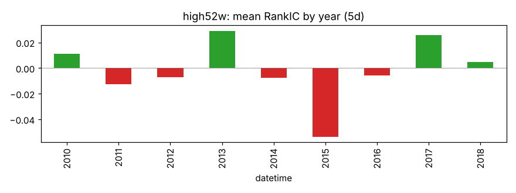
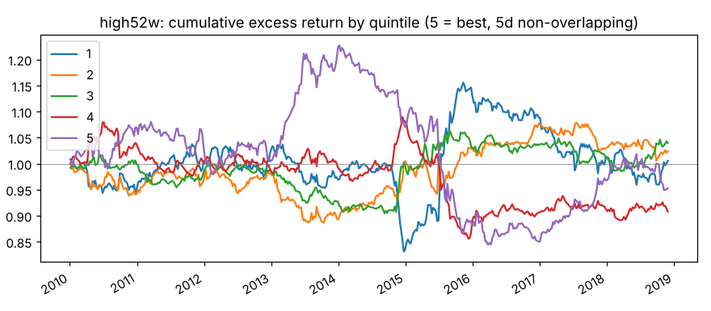
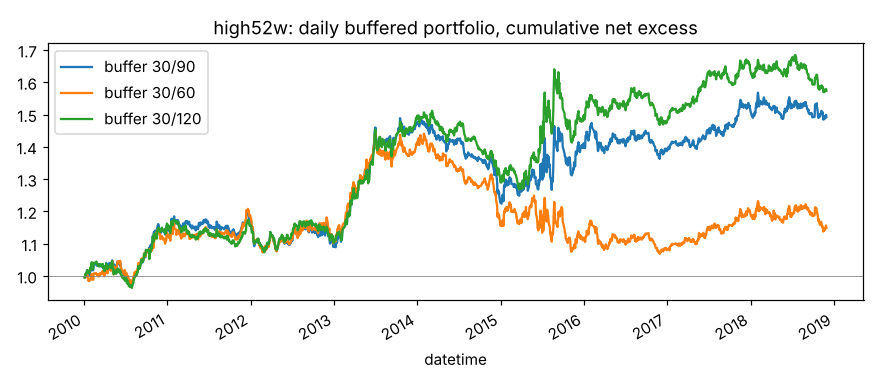

# high52w

收盘价 / 过去 250 日最高价（52 周新高）。来源：George & Hwang (2004)。

- 表达式：`$close/Max($high,250)`
- 方向：+1（越大越好），依据：文献
- 样本：csi300 历史成分，train 段 2010-01-01 ~ 2018-11-29（段尾去掉 21 个交易日），2166 个交易日；能买入的样本占 94.0%；已对申万一级行业（当天不足 5 只的行业合并为“其他”）和对数流通市值做中性化；行业和市值都有数据的样本占 98.1%，其中 6.7% 的市值缺股本数据、用对数 20 日平均成交额估算（估算值与真实值的每日相关系数平均 0.54、最低 0.20）

## 结论：淘汰

作为打分因子：

- ❌ t 值 > 3
- ❌ 方向反了的年份不超过一半
- ✅ 按实际交易规则（30/90）扣成本后做多超额 > 0

作为排雷因子：

- ❌ t 值 > 3
- ❌ 方向反了的年份不超过一半
- ❌ 最低组年化超额 < 0
- ❌ 最低组超额 t 值 < -3

## IC（已按方向调整，正数表示和预期方向一致）

|       |   RankIC 均值 |   标准差 |    ICIR |   IC>0 占比 |   t 值（NW） |   天数 |
|:------|--------------:|---------:|--------:|------------:|-------------:|-------:|
| 1 天  |       -0.0061 |   0.1274 | -0.0480 |      0.4739 |      -2.2361 |   2165 |
| 2 天  |       -0.0045 |   0.1328 | -0.0340 |      0.4882 |      -1.2788 |   2165 |
| 3 天  |       -0.0045 |   0.1355 | -0.0332 |      0.4882 |      -1.0578 |   2165 |
| 5 天  |       -0.0019 |   0.1375 | -0.0140 |      0.5136 |      -0.3549 |   2165 |
| 10 天 |        0.0035 |   0.1427 |  0.0246 |      0.5206 |       0.4401 |   2165 |
| 20 天 |        0.0093 |   0.1436 |  0.0647 |      0.5192 |       0.8283 |   2165 |

- Pearson IC（5 天，去极值和标准化之后）：-0.0013，t 值 -0.24
- 回归法（5 天远期收益对标准化因子做横截面回归）：因子收益率均值 -0.00004，t 值 -0.15。只作参考，不设门槛

## 分年度

方向反了的年份占比：56%

|   年份 |   RankIC 均值 |
|-------:|--------------:|
|   2010 |        0.0110 |
|   2011 |       -0.0128 |
|   2012 |       -0.0072 |
|   2013 |        0.0292 |
|   2014 |       -0.0074 |
|   2015 |       -0.0537 |
|   2016 |       -0.0058 |
|   2017 |        0.0259 |
|   2018 |        0.0047 |

## 分层（每 5 个交易日一次、互不重叠，5 组）

只用来看信号质量和单调性，不扣成本。

|         |   年化超额（相对等权全体） |
|:--------|---------------------------:|
| 第 1 组 |                      0.33% |
| 第 2 组 |                      0.42% |
| 第 3 组 |                      0.54% |
| 第 4 组 |                     -1.00% |
| 第 5 组 |                     -0.29% |

- 单调性（组号与平均超额的 Spearman 相关）：-0.50
- 最低组年化超额 0.33%，t 值 0.13

## 按实际交易规则模拟

每天调仓，持仓 30 只等权；排名进前 30 才买，已持有的排名掉出缓冲线才卖。
买不进（入场日停牌或涨停）跳过，卖不掉（入场日停牌或跌停）继续持有。
成本：买入 0.125%，卖出佣金 + 印花税 + 滑点（docs/DECISIONS.md），最低 5 元佣金不计。
超额默认相对当天有打分、且第二天能买进的股票等权平均（筛选门槛用这个）；
最后一列相对所有有打分的股票，包括第二天涨停买不进的，作参考。两者都不是相对沪深300 指数。

|             |   日均单边换手 |   年化超额（扣成本前） |   年化成本 |   年化超额（扣成本后） |   扣成本后 t 值 |   扣成本后（参考：全体基准） |
|:------------|---------------:|-----------------------:|-----------:|-----------------------:|----------------:|-----------------------------:|
| 缓冲 30/90  |         0.0203 |                 0.0692 |     0.0180 |                 0.0512 |          1.5704 |                       0.0073 |
| 缓冲 30/60  |         0.0299 |                 0.0470 |     0.0265 |                 0.0206 |          0.6401 |                      -0.0233 |
| 缓冲 30/120 |         0.0160 |                 0.0711 |     0.0142 |                 0.0569 |          1.8384 |                       0.0130 |

