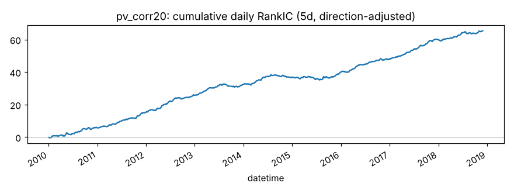
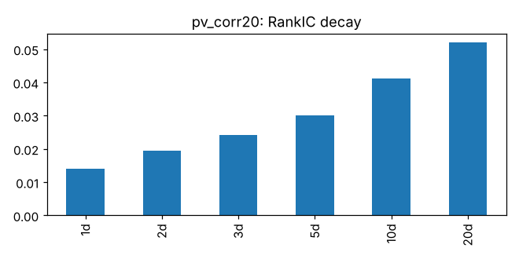
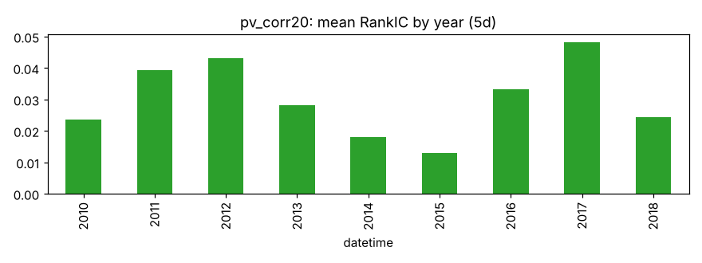
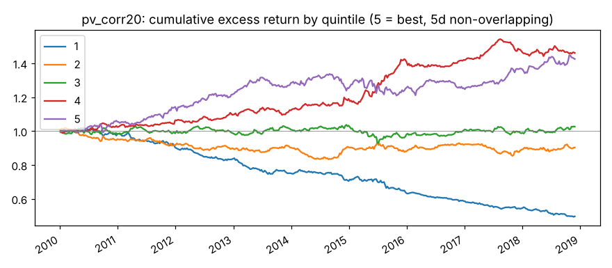
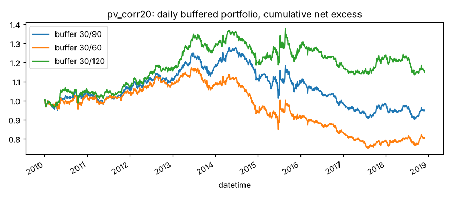

# pv_corr20

20 日收盘价与对数成交量的相关性。来源：Alpha158 CORR 类。

- 表达式：`Corr($close,Log($volume+1),20)`
- 方向：-1（越小越好），依据：训练段实际 RankIC
- 样本：csi300 历史成分，train 段 2010-01-01 ~ 2018-11-29（段尾去掉 21 个交易日），2166 个交易日；能买入的样本占 94.0%；已对申万一级行业（当天不足 5 只的行业合并为“其他”）和对数流通市值做中性化；行业和市值都有数据的样本占 98.1%，其中 6.7% 的市值缺股本数据、用对数 20 日平均成交额估算（估算值与真实值的每日相关系数平均 0.54、最低 0.20）

## 结论：排雷因子

作为打分因子：

- ✅ t 值 > 3
- ✅ 方向反了的年份不超过一半
- ❌ 按实际交易规则（30/90）扣成本后做多超额 > 0

作为排雷因子：

- ✅ t 值 > 3
- ✅ 方向反了的年份不超过一半
- ✅ 最低组年化超额 < 0
- ✅ 最低组超额 t 值 < -3

## IC（已按方向调整，正数表示和预期方向一致）

|       |   RankIC 均值 |   标准差 |   ICIR |   IC>0 占比 |   t 值（NW） |   天数 |
|:------|--------------:|---------:|-------:|------------:|-------------:|-------:|
| 1 天  |        0.0140 |   0.0869 | 0.1609 |      0.5640 |       7.4894 |   2165 |
| 2 天  |        0.0196 |   0.0850 | 0.2303 |      0.5829 |       8.9095 |   2165 |
| 3 天  |        0.0242 |   0.0855 | 0.2835 |      0.6148 |       9.3566 |   2165 |
| 5 天  |        0.0302 |   0.0851 | 0.3548 |      0.6379 |       9.4860 |   2165 |
| 10 天 |        0.0412 |   0.0850 | 0.4846 |      0.6905 |       9.6890 |   2165 |
| 20 天 |        0.0520 |   0.0798 | 0.6512 |      0.7524 |       9.4974 |   2165 |

- Pearson IC（5 天，去极值和标准化之后）：0.0234，t 值 7.17
- 回归法（5 天远期收益对标准化因子做横截面回归）：因子收益率均值 0.00088，t 值 5.71。只作参考，不设门槛

## 分年度

方向反了的年份占比：0%

|   年份 |   RankIC 均值 |
|-------:|--------------:|
|   2010 |        0.0236 |
|   2011 |        0.0392 |
|   2012 |        0.0431 |
|   2013 |        0.0282 |
|   2014 |        0.0181 |
|   2015 |        0.0130 |
|   2016 |        0.0333 |
|   2017 |        0.0482 |
|   2018 |        0.0244 |

## 分层（每 5 个交易日一次、互不重叠，5 组）

只用来看信号质量和单调性，不扣成本。

|         |   年化超额（相对等权全体） |
|:--------|---------------------------:|
| 第 1 组 |                     -8.01% |
| 第 2 组 |                     -1.09% |
| 第 3 组 |                      0.39% |
| 第 4 组 |                      4.49% |
| 第 5 组 |                      4.27% |

- 单调性（组号与平均超额的 Spearman 相关）：0.90
- 最低组年化超额 -8.01%，t 值 -5.11

## 按实际交易规则模拟

每天调仓，持仓 30 只等权；排名进前 30 才买，已持有的排名掉出缓冲线才卖。
买不进（入场日停牌或涨停）跳过，卖不掉（入场日停牌或跌停）继续持有。
成本：买入 0.125%，卖出佣金 + 印花税 + 滑点（docs/DECISIONS.md），最低 5 元佣金不计。
超额默认相对当天有打分、且第二天能买进的股票等权平均（筛选门槛用这个）；
最后一列相对所有有打分的股票，包括第二天涨停买不进的，作参考。两者都不是相对沪深300 指数。

|             |   日均单边换手 |   年化超额（扣成本前） |   年化成本 |   年化超额（扣成本后） |   扣成本后 t 值 |   扣成本后（参考：全体基准） |
|:------------|---------------:|-----------------------:|-----------:|-----------------------:|----------------:|-----------------------------:|
| 缓冲 30/90  |         0.0680 |                 0.0575 |     0.0601 |                -0.0026 |         -0.0964 |                      -0.0493 |
| 缓冲 30/60  |         0.0897 |                 0.0571 |     0.0792 |                -0.0221 |         -0.8288 |                      -0.0688 |
| 缓冲 30/120 |         0.0549 |                 0.0681 |     0.0485 |                 0.0196 |          0.7417 |                      -0.0271 |

