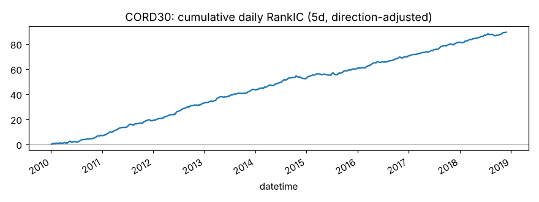
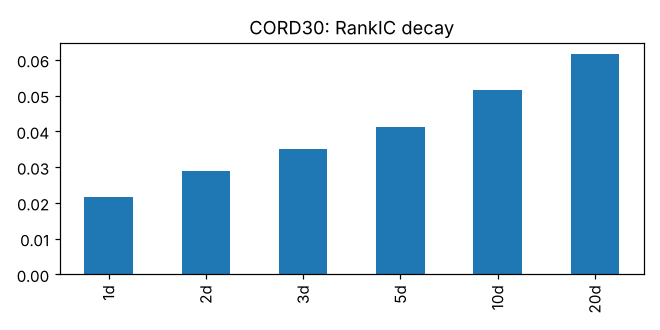
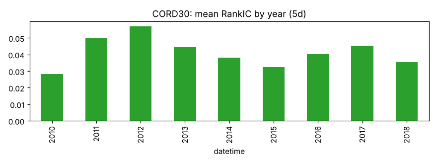
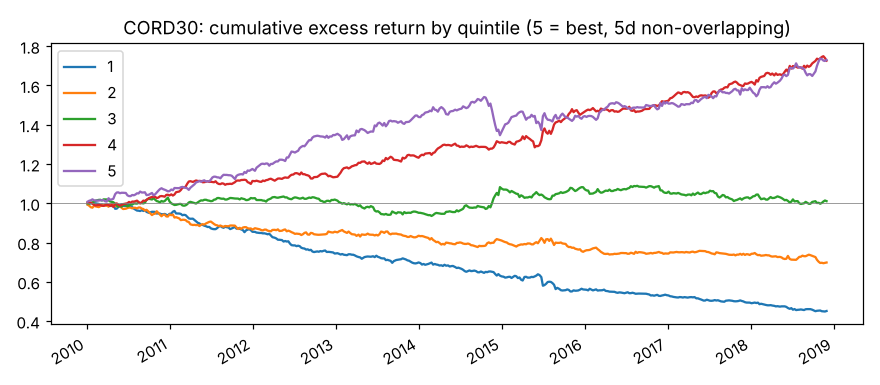
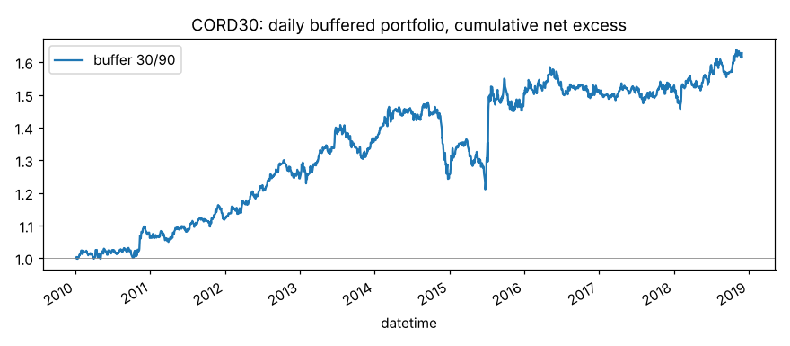

# CORD30

价格变化与成交量变化相关，30 日窗口。来源：Qlib Alpha158。

- 表达式：`Corr($close/Ref($close,1), Log($volume/Ref($volume, 1)+1), 30)`
- 方向：-1（越小越好），依据：训练段实际 RankIC
- 样本：csi300 历史成分，train 段 2010-01-01 ~ 2018-11-29（段尾去掉 21 个交易日），2166 个交易日；能买入的样本占 94.0%；已对申万一级行业（当天不足 5 只的行业合并为“其他”）和对数流通市值做中性化；行业和市值都有数据的样本占 98.1%，其中 6.7% 的市值缺股本数据、用对数 20 日平均成交额估算（估算值与真实值的每日相关系数平均 0.54、最低 0.20）

## 结论：打分因子

作为打分因子：

- ✅ t 值 > 3
- ✅ 方向反了的年份不超过一半
- ✅ 按实际交易规则（30/90）扣成本后做多超额 > 0

作为排雷因子：

- ✅ t 值 > 3
- ✅ 方向反了的年份不超过一半
- ✅ 最低组年化超额 < 0
- ✅ 最低组超额 t 值 < -3

## IC（已按方向调整，正数表示和预期方向一致）

|       |   RankIC 均值 |   标准差 |   ICIR |   IC>0 占比 |   t 值（NW） |   天数 |
|:------|--------------:|---------:|-------:|------------:|-------------:|-------:|
| 1 天  |        0.0217 |   0.0864 | 0.2513 |      0.5945 |      11.6946 |   2165 |
| 2 天  |        0.0290 |   0.0865 | 0.3358 |      0.6286 |      12.9893 |   2165 |
| 3 天  |        0.0351 |   0.0852 | 0.4121 |      0.6651 |      13.5047 |   2165 |
| 5 天  |        0.0413 |   0.0843 | 0.4897 |      0.6942 |      13.0063 |   2165 |
| 10 天 |        0.0515 |   0.0834 | 0.6174 |      0.7210 |      12.0126 |   2165 |
| 20 天 |        0.0615 |   0.0758 | 0.8112 |      0.7963 |      11.9436 |   2165 |

- Pearson IC（5 天，去极值和标准化之后）：0.0313，t 值 9.77
- 回归法（5 天远期收益对标准化因子做横截面回归）：因子收益率均值 0.00118，t 值 7.64。只作参考，不设门槛

## 分年度

方向反了的年份占比：0%

|   年份 |   RankIC 均值 |
|-------:|--------------:|
|   2010 |        0.0283 |
|   2011 |        0.0499 |
|   2012 |        0.0571 |
|   2013 |        0.0445 |
|   2014 |        0.0381 |
|   2015 |        0.0324 |
|   2016 |        0.0402 |
|   2017 |        0.0453 |
|   2018 |        0.0353 |

## 分层（每 5 个交易日一次、互不重叠，5 组）

只用来看信号质量和单调性，不扣成本。

|         |   年化超额（相对等权全体） |
|:--------|---------------------------:|
| 第 1 组 |                     -9.10% |
| 第 2 组 |                     -4.07% |
| 第 3 组 |                      0.22% |
| 第 4 组 |                      6.43% |
| 第 5 组 |                      6.52% |

- 单调性（组号与平均超额的 Spearman 相关）：1.00
- 最低组年化超额 -9.10%，t 值 -5.17

## 按实际交易规则模拟

每天调仓，持仓 30 只等权；排名进前 30 才买，已持有的排名掉出缓冲线才卖。
买不进（入场日停牌或涨停）跳过，卖不掉（入场日停牌或跌停）继续持有。
成本：买入 0.125%，卖出佣金 + 印花税 + 滑点（docs/DECISIONS.md），最低 5 元佣金不计。
超额默认相对当天有打分、且第二天能买进的股票等权平均（筛选门槛用这个）；
最后一列相对所有有打分的股票，包括第二天涨停买不进的，作参考。两者都不是相对沪深300 指数。

|            |   日均单边换手 |   年化超额（扣成本前） |   年化成本 |   年化超额（扣成本后） |   扣成本后 t 值 |   扣成本后（参考：全体基准） |
|:-----------|---------------:|-----------------------:|-----------:|-----------------------:|----------------:|-----------------------------:|
| 缓冲 30/90 |         0.0402 |                 0.0953 |     0.0356 |                 0.0597 |          2.2427 |                       0.0136 |

