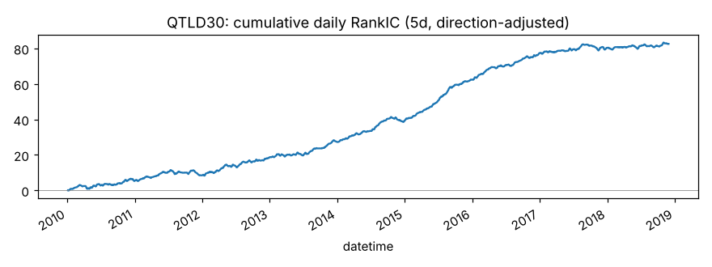
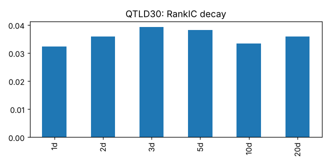
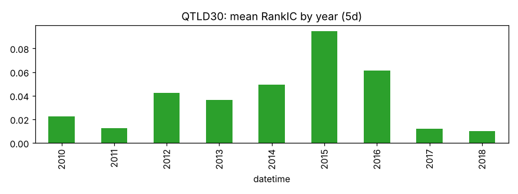
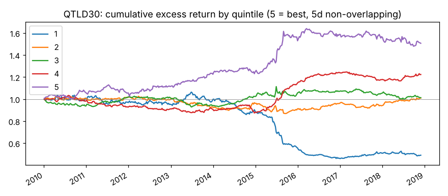
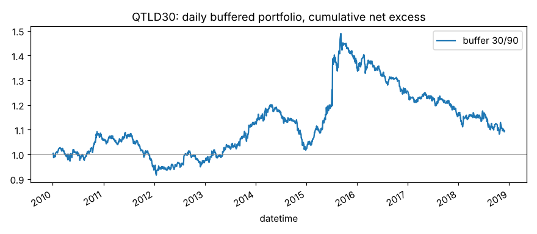

# QTLD30

收盘价 20% 分位，30 日窗口。来源：Qlib Alpha158。

- 表达式：`Quantile($close, 30, 0.2)/$close`
- 方向：+1（越大越好），依据：训练段实际 RankIC
- 样本：csi300 历史成分，train 段 2010-01-01 ~ 2018-11-29（段尾去掉 21 个交易日），2166 个交易日；能买入的样本占 94.0%；已对申万一级行业（当天不足 5 只的行业合并为“其他”）和对数流通市值做中性化；行业和市值都有数据的样本占 98.1%，其中 6.7% 的市值缺股本数据、用对数 20 日平均成交额估算（估算值与真实值的每日相关系数平均 0.54、最低 0.20）

## 结论：打分因子

作为打分因子：

- ✅ t 值 > 3
- ✅ 方向反了的年份不超过一半
- ✅ 按实际交易规则（30/90）扣成本后做多超额 > 0

作为排雷因子：

- ✅ t 值 > 3
- ✅ 方向反了的年份不超过一半
- ✅ 最低组年化超额 < 0
- ❌ 最低组超额 t 值 < -3

## IC（已按方向调整，正数表示和预期方向一致）

|       |   RankIC 均值 |   标准差 |   ICIR |   IC>0 占比 |   t 值（NW） |   天数 |
|:------|--------------:|---------:|-------:|------------:|-------------:|-------:|
| 1 天  |        0.0323 |   0.1278 | 0.2524 |      0.6032 |      11.7464 |   2165 |
| 2 天  |        0.0359 |   0.1284 | 0.2794 |      0.6194 |      10.8067 |   2165 |
| 3 天  |        0.0392 |   0.1281 | 0.3061 |      0.6268 |      10.1762 |   2165 |
| 5 天  |        0.0382 |   0.1255 | 0.3040 |      0.6166 |       8.2509 |   2165 |
| 10 天 |        0.0334 |   0.1227 | 0.2725 |      0.6051 |       5.3918 |   2165 |
| 20 天 |        0.0358 |   0.1135 | 0.3155 |      0.6199 |       4.5876 |   2165 |

- Pearson IC（5 天，去极值和标准化之后）：0.0215，t 值 4.55
- 回归法（5 天远期收益对标准化因子做横截面回归）：因子收益率均值 0.00094，t 值 4.09。只作参考，不设门槛

## 分年度

方向反了的年份占比：0%

|   年份 |   RankIC 均值 |
|-------:|--------------:|
|   2010 |        0.0223 |
|   2011 |        0.0126 |
|   2012 |        0.0421 |
|   2013 |        0.0362 |
|   2014 |        0.0493 |
|   2015 |        0.0947 |
|   2016 |        0.0615 |
|   2017 |        0.0123 |
|   2018 |        0.0099 |

## 分层（每 5 个交易日一次、互不重叠，5 组）

只用来看信号质量和单调性，不扣成本。

|         |   年化超额（相对等权全体） |
|:--------|---------------------------:|
| 第 1 组 |                     -7.91% |
| 第 2 组 |                      0.21% |
| 第 3 组 |                      0.27% |
| 第 4 组 |                      2.45% |
| 第 5 组 |                      4.97% |

- 单调性（组号与平均超额的 Spearman 相关）：1.00
- 最低组年化超额 -7.91%，t 值 -2.79

## 按实际交易规则模拟

每天调仓，持仓 30 只等权；排名进前 30 才买，已持有的排名掉出缓冲线才卖。
买不进（入场日停牌或涨停）跳过，卖不掉（入场日停牌或跌停）继续持有。
成本：买入 0.125%，卖出佣金 + 印花税 + 滑点（docs/DECISIONS.md），最低 5 元佣金不计。
超额默认相对当天有打分、且第二天能买进的股票等权平均（筛选门槛用这个）；
最后一列相对所有有打分的股票，包括第二天涨停买不进的，作参考。两者都不是相对沪深300 指数。

|            |   日均单边换手 |   年化超额（扣成本前） |   年化成本 |   年化超额（扣成本后） |   扣成本后 t 值 |   扣成本后（参考：全体基准） |
|:-----------|---------------:|-----------------------:|-----------:|-----------------------:|----------------:|-----------------------------:|
| 缓冲 30/90 |         0.0862 |                 0.0902 |     0.0761 |                 0.0140 |          0.5012 |                      -0.0298 |

